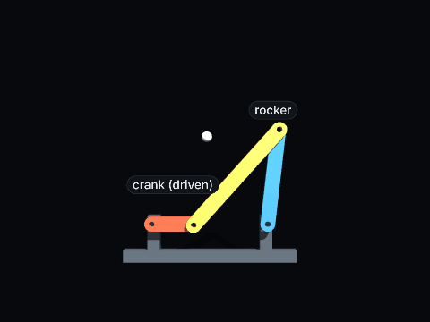
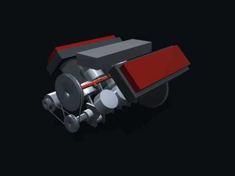

# GearScript


**Describe mechanisms in a CSS-like language. Watch them move.**

**[gearscript.org](https://gearscript.org)** · [Open the studio](https://gearscript.org/studio.html) · [Documentation](https://gearscript.org/help.html)

GearScript is a small language and browser-based studio for describing and animating mechanisms, from linkages and gears to engines, robots and 2D explainers. Its syntax is designed to be approachable for people and predictable for AI models.

The name says what it does: a script for machines. Write how the parts connect, turn one gear, and everything moves in step.

[](LICENSE)

[](CHANGELOG.md)
[](https://github.com/Hypertoroid/GearScript/actions/workflows/ci.yml)

---

## In motion

| Four-bar linkage | V8 engine |
|:--|:--|
|  |  |
| Crank, coupler and rocker moving together. | Eight pistons driven by a single crankshaft. |

---

```css
@scene
Crank::Link   { length: 40mm;  width: 14mm; hinge: end.a on (0, 0, 0); }
Coupler::Link { length: 120mm; width: 14mm; hinge: end.a on Crank.end.b + (0, 0, 6mm);
                pin: end.b to Rocker.end.b; }
Rocker::Link  { length: 90mm;  width: 14mm; orient: 90deg about z; hinge: end.a on (110mm, 0, 0); }

@style
Crank   { color: #b8442e; }
Coupler { color: #e0a63a; }
Rocker  { color: #2f6f8f; }

@motion
Crank { forever: rotate: 180deg/s; }   // drive one part; the solver moves the rest
```

You drive only the crank. GearScript solves the closed loop at every frame, so the coupler and rocker follow the way real parts would. When something can't be built, you get an error that says why and what to write instead.

## What makes it different

- **Joints, not keyframes.** Hinges, sliders, pins, gears, belts and rolling contact are part of the language. Parts move because they are connected, not because you animated each one.
- **Errors that teach.** Over 100 numbered errors and warnings, each with a fix. For example, `E0353: The linkage locks at 1.20s: Rocker.end.b can no longer meet`, followed by what to change. That's what lets an AI correct its own code.
- **Anchors instead of coordinates.** `at: Base.face.top`, `hinge: end.a on Crank.end.b`, `com.z` for a part's true centre of mass. Every shape names its useful points and axes.
- **Everything runs in the browser.** No install, no account, no server needed to edit, preview or export.
- **Sound that follows the motion.** `sound: Knock at end;` plays when a part lands; `sound: Tick every 1s;` keeps time. 34 built-in sounds, all generated, so free of copyright, and carried into MP4 and WebM.
- **CSS-like looks, including light.** Colours, gradients, materials, roughness and metalness, outlines, opacity, and `luminosity: 80%;` for parts that shine and light their surroundings. Colour, opacity and luminosity animate like anything else: `color: #2f6fb0 -> #e0a63a;`.
- **Chapters for longer videos.** Each chapter is a complete animation starting at 0 s; Film plays them in order with fades and crossfades, and the export joins them into one video. `extends` lets a chapter start from another's scene.
- **Cutaways and exploded views.** `cut: z 0mm;` opens a part with a section plane, `material: ghost;` sees through a casing, and `explode: 0 -> 1` pulls an assembly apart.
- **Words, charts and narration.** Text on parts or as parts (flat or solid 3D letters, in nine bundled video fonts that look the same in every export), `Plot` charts that draw themselves on, and `say:` lines spoken by the browser with captions burned into exports and saved as .srt or .vtt. Audio files work as voice-overs and music.
- **Any format.** `frame: reel;` (or youtube-short, tiktok, slides, 4k, a ratio or pixels) shows the exact picture with its safe area; `sky: dusk;` wraps the scene in a sky.
- **Many outputs.** MP4, WebM, GIF, PNG frames (with transparency), a self-contained `.html` 3D player, and the project itself as one `.gscript` file or three files.
- **Made for AI.** A short syntax prompt (and, on a server with an API key, Generate and Fix with AI in the studio), a JSON schema of the language (`gearscript schema`), `check --fix`, an MCP server for agents, a command-line checker, "copy the state at time t" to show an AI exactly what went wrong, and an evaluation set.

## Quick start

**In the browser:** go to [gearscript.org/studio.html](https://gearscript.org/studio.html), or open `studio.html` from a copy of this repository (`index.html` is the landing page). Pick something from **Examples**, or start typing; the hints suggest shapes, properties and anchors as you go. From the published site you can install it as an app (it then works offline), download it as one HTML file, and send any project as a link.

**From the command line** (Node 18 or later):

```sh
cd cli && npm install
node gearscript.js check   ../examples/linkage.gscript
node gearscript.js sample  ../examples/linkage.gscript --at 0,1,2 --parts Rocker
node gearscript.js render  ../examples/linkage.gscript -o linkage.mp4     # also .webm .gif .png frames.zip sound.wav
node gearscript.js format  ../examples/linkage.gscript --write            # beautify: lay the code out like CSS
node gearscript.js test                                              # every example still moves as saved
node gearscript.js prompt  "a pendulum clock"                        # the AI syntax prompt
node gearscript.js mcp                                               # an MCP server for AI agents
```

Rendering drives the studio in a headless browser, so it needs Playwright or a local Chrome.

## Repository layout

```
index.html       landing page
studio.html      the studio: the language core (<script id="core">) and the app (<script id="app">)
help.html        the documentation
privacy.html     privacy policy and terms of use for gearscript.org
terms.html
site-config.js   owner, contact address and links that the pages show
CNAME            the custom domain for GitHub Pages (gearscript.org)
vendor/          three.js, CodeMirror 6, video muxers and fonts, bundled
cli/             command-line tool and MCP server
server/          optional server for self-hosting: opt-in usage statistics and AI Generate and Fix
examples/        example projects
tests/           saved motion that every example must still match
evals/           AI evaluation tasks
docs/            the animations in this README and the language's JSON schema
brand/           logo files (see TRADEMARKS.md)
```

The studio is one HTML file with no build step. Edit it, reload, done.

## The website and your own copy

The official site, [gearscript.org](https://gearscript.org), is these files served as they are by GitHub Pages. There is no server behind it: the studio runs entirely in the browser, and visits are counted with GoatCounter, which sets no cookies (see the [privacy policy](https://gearscript.org/privacy.html)).

You can host your own copy anywhere that serves static files. See [SELF-HOSTING.md](SELF-HOSTING.md), which also covers the optional `server/`. If you run a public copy, call it something other than "GearScript" (see [TRADEMARKS.md](TRADEMARKS.md)), and replace `CNAME`, `site-config.js`, `privacy.html` and `terms.html` with your own. The GoatCounter tags run only on gearscript.org, so your copy sends no statistics to it.

## Contributing

Bug reports, examples, shapes, docs and fixes are all welcome. Start with [CONTRIBUTING.md](CONTRIBUTING.md). Ideas for the language itself start as an issue, because every new keyword is something people and models have to learn.

Please follow the [code of conduct](CODE_OF_CONDUCT.md). To report a security problem privately, see [SECURITY.md](SECURITY.md).

## Licence

GearScript is open source under the [Apache License 2.0](LICENSE). You may use it, change it and ship it, including commercially. Keep the licence and the [NOTICE](NOTICE) file with copies.

Created by **Sivaprasad Murali**. Animations, videos and `.gscript` projects you make with GearScript are yours. The licence covers the software, not what you create with it.

The name "GearScript" and the logo are not covered by the code licence. See [TRADEMARKS.md](TRADEMARKS.md).

Third-party parts keep their own licences: three.js, CodeMirror 6 (bundled in `vendor/`), mp4-muxer and webm-muxer are MIT. See [NOTICE](NOTICE).
